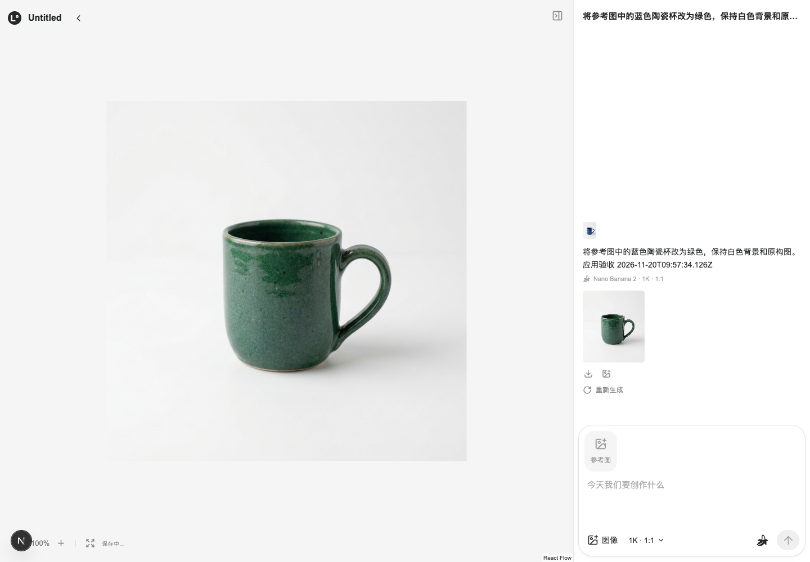
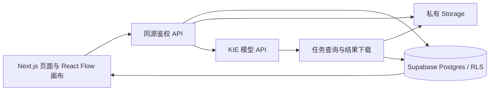

# Lovart Agent · 画布式 AI 图像工作台

[](https://github.com/zenyarn/lovart-agent/actions/workflows/ci.yml)

以 Lovart 的画布交互为参考，使用 **Next.js + Supabase + React Flow** 实现的个人图像生成项目。用户输入提示词、上传或选择参考图，通过 **Nano Banana 2 / GPT Image2** 生成图片，并在画布中管理结果。



## 功能

- **项目工作流**：首页提示词与单图上传，最近项目、全部项目、项目重命名；发送后自动进入画布。
- **交互画布**：图片节点拖动、平移缩放、首次结果自动适配、图片下载；位置与视口自动保存。
- **生成面板**：320–620px 拖动调宽、移动端切换；两种模型独立配置、单图参考、任务历史和手动重试。
- **可恢复生成**：任务与占位节点持久化；刷新恢复查询；成功结果搬运至私有 Storage，保存失败只重试保存。
- **数据隔离**：邮箱准入、Supabase Auth、owner RLS、私有图片签名访问；密钥仅在服务端使用。

## 工程实现

| 关注点 | 实现方式 |
| --- | --- |
| 防止重复计费 | 请求幂等键、每用户一个活跃任务、数据库原子创建；受理结果未知时等待核实 |
| 异步一致性 | 同步租约、配置快照、原占位节点替换、结果保存事务 |
| 多标签保存 | revision 乐观锁、完整快照同步、冲突提示、条件清理本地草稿 |
| 文件安全 | 限额读取、实际图片解码、所有权校验、逐跳校验远程下载并限制公网地址 |
| 用户操作恢复 | 上传/发送期间保护编辑，恢复参考图成功前禁止发送，失败提供重试/移除 |
| 验证 | Vitest、PGlite、Testing Library、Playwright，独立代码审核及真实模型调用 |



技术栈：TypeScript、Next.js App Router、React、`@xyflow/react`、`@lobehub/icons`、Supabase SSR、Zod、Sharp、pnpm。

## 本地启动

建议 Node.js 22.22.3，项目锁定 pnpm 11.1.3。

```bash
npm install -g pnpm@11.1.3
pnpm install --frozen-lockfile
cp .env.example .env
```

在 `.env` 填入自己的 Supabase URL、publishable key、服务端 secret key、KIE API key、准入邮箱；已有配置时不要覆盖 `.env`。按 [Supabase 初始化说明](docs/api/supabase-setup.md) 创建表、私有 Bucket 并配置认证回跳，然后运行：

```bash
pnpm dev
```

打开 [localhost:3000](http://localhost:3000)，首次设置账户密码、完成邮箱验证后登录。

## 验证与运行

```bash
pnpm test       # 53 项单元/数据库/组件测试
pnpm typecheck
pnpm lint
pnpm build
pnpm start     # 生产模式，先停止占用 3000 端口的开发进程
```

已完成真实首页上传 → 模型受理 → 画布轮询 → 私有存储 → 图片显示的完整链路。四项独立 Chrome 测试验证页面跳转、图片加载、模型配置、参考图选择、面板宽度、移动布局与刷新恢复。浏览器测试需要真实已配置的测试环境，见 [运行与测试说明](docs/development.md)。CI 不持有真实服务密钥，也不会触发收费生成。

这是个人本地版。正式公网部署、SMTP、Webhook 和后台定时任务按部署环境另行配置；当前关闭浏览器后任务保留，重新打开恢复查询。

## 项目文档

- [需求文档](docs/prd.md) · [进度看板](docs/progress.md)
- [接口契约](docs/api/app-api.md) · [模型对接说明](docs/api/integration-plan.md)
- [验收记录](docs/verification.md) · [独立审核与已知小问题](docs/review.md)
- [本地运行与维护](docs/development.md)

## 项目说明

本项目作为个人全栈开发实践，交互参考 Lovart，模型能力通过 KIE 对接。参考截图和官方接口文档用于说明设计及对接依据，其来源见文档目录。早期本地阶段提交保留在本机备份分支；公开历史从清理个人配置后的版本开始，后续按阶段持续提交。
