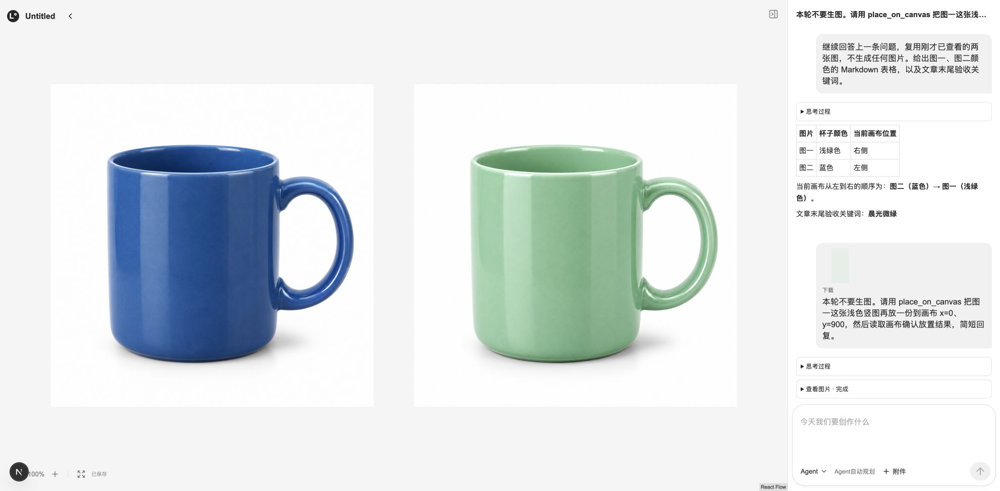
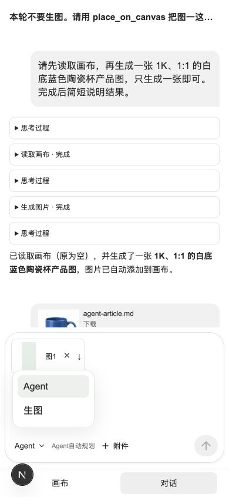

# Pi Agent 验收记录

日期：2026-11-21。分支：`feat/pi-agent-skills`，基线：`8a235e4`。

## 已验证体验

| 项目 | 证据与结果 |
| --- | --- |
| 共用输入框与模式下拉 | Chrome 键盘切换 Agent/生图、Esc 关闭；Agent 隐藏模型参数，普通生图保留原配置。组件测试覆盖发送期间禁用和立即清空。 |
| 附件 | Chrome 真实上传 Markdown、PNG，直接从剪贴板粘贴 PNG；图片自动进入画布。拖放 Markdown 与粘贴文件事件另有组件测试。 |
| 预览与下载 | Chrome Markdown 预览完整显示原文；私有签名下载响应 HTTP 200、Content-Disposition 为原文件名，返回内容与上传原文一致。Chrome 下载事件回传超时，未将浏览器下载目录检查列为通过项。 |
| 有序参考图 | 先选绿杯、再选蓝杯，输入框标为图1/图2；Kimi 真实 view_image 后回复正确对应顺序，未按画布左右位置误编号。 |
| Markdown 全文 | 文末 HTML 注释内的测试关键词“晨光微绿”被服务端完整传入，Kimi 正确回答。 |
| 五个工具 | list_assets、view_image、generate_image、place_on_canvas、read_canvas 均有真实完成事件。放置工具实际创建 x=0、y=900、400×800 的素材节点，随后读取确认。 |
| GPT Image 2.5 文生图 | 真实生成蓝色陶瓷杯，记录 model=gpt25，providerModel=gpt-image-2-5-flare-text-to-image，状态 succeeded。 |
| GPT Image 2.5 图生图 | 基于蓝杯改为浅绿色，杯型保留；记录保存有序 referenceAssetIds、1K、1:1 与 gpt-image-2-5-flare-image-to-image，状态 succeeded。没有沿用旧模型。 |
| 流式输出 | SSE 持久事件流展示文本、思考、工具参数/结果；重连重放历史，不依赖前端保存模型上下文。 |
| 画布边界与缩放 | 上传 400×800 竖图，DOM 节点尺寸与 img 尺寸一致；手柄等比缩放为306×612，拖动位置与尺寸在数据库、刷新后均一致。 |
| 复制与删除 | Chrome 标准剪贴板复制粘贴创建副本；Backspace 和 Delete 删除节点；刷新后保持删除，原素材记录仍在。文字输入框 Backspace 不删节点。 |
| 窄屏 | Chrome 390×844 与320×720检查：模式菜单向上展开，配置可换行，发送按钮仍在输入框边界内。已重置视口。 |
| 安全 | Markdown 禁止 HTML、危险链接和远程模型图片嵌入；数据库/工具测试验证归属、幂等、revision 冲突、先看图再生成。密钥仅服务端读取。 |

## 联调中发现并修复

1. 独立审核：未保存删除节点被刷新合并恢复、本地草稿丢失尺寸和删除、失败轮次丢失已完成工具结果、GPT2.5 重试按钮语义与直接提交不符。均已修复并有针对性测试。
2. 复制粘贴：只监听 keydown 无法覆盖浏览器剪贴板操作，改为标准 copy/paste 事件；Chrome 复验成功。
3. Kimi 账户实际限制3 RPM，多步调用曾返回429。加入默认21000ms进程内共享请求间隔，可通过 KIMI_REQUEST_INTERVAL_MS 调整；失败历史保留。修复后真实“查看→放置→读取→最终回复”完整成功。
4. 图生图曾短暂进入结果保存错误，既有同步流程恢复成功，没有重新提交收费生成。工具现在将未确认状态作为错误结果交给模型说明，并阻止本轮再次提交生图。
5. 连续保存后本地草稿仅因 revision 不同而残留，刷新误报旧草稿。现按节点、视口和配置确认是否已保存；真正不同的草稿仍保留。
6. 网络失败的发送请求保留到本地，重试沿用原请求ID；20分钟无更新的遗留运行转失败，保留已有生成任务。

## 自动化与边界

- `pnpm test`：84项单元、组件、数据库测试通过。
- `pnpm typecheck`、`pnpm lint`：通过。
- `pnpm build`：通过；`pnpm start` 后 Chrome 刷新，Agent模式、两张结果与历史恢复正常，旧草稿误报为0。
- 普通 Nano/GPT Image2 的参数和生成逻辑由既有回归测试覆盖，本轮没有为旧模型新增收费任务。
- 测试用竖图节点已移除，源素材仍保留；演示画布保留蓝杯和绿杯。
- 当前为单实例本地验收。多实例部署应改用共享速率限制，并配置支持长运行任务的执行环境；本轮未部署线上或推送远端。

## 截图

